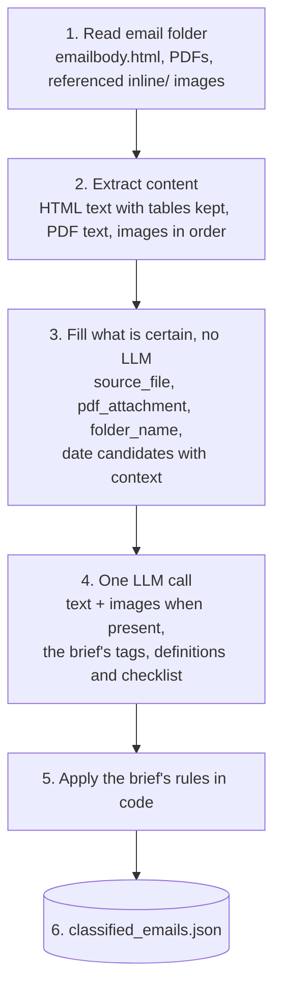

# PRD: Market Research Email Classifier & Dashboard

Nov 10, 2026 · Caleb

## Goal

Take our unstructured data (market research emails about different asset classes, industries and companies) and turn it into a clean dashboard that analysts can use to browse, filter and read the research.

Two parts, as the brief defines them:

- **Classification pipeline** (`classify.py`): reads each email folder, tags it with asset classes, industries and companies using an LLM, and writes `classified_emails.json`, one entry per email.
- **Dashboard** (`index.html` + `style.css` + `app.js`): reads that JSON and lets an analyst browse, search, filter and read each email, with a live news ticker on top.

This doc goes through the four human steps we took to get there:

1. Research
2. General Ideas / Options
3. Experiment & Firmed Choices
4. Evaluate

Most of it covers the classification pipeline. The dashboard requirements sit at the end.

## 1. Research

### General look and feel

My general look and feel for everything... a Python classification pipeline:

```
Read raw market emails
HTML Parser
Tags email contents with asset classes, industries and companies
Produces a structured output (into our database)
```

The "database" here is `classified_emails.json`, one entry per email, with exactly the ten fields the brief lists. Nothing gets added to that output.

So let's explore our approaches then for each of these sub processes...

### Data Reader

Iterate through the data folder... the brief fixes what an email folder contains:

```
emailbody.html   the full HTML content of the email
*.pdf            one or more attachments, where present
inline/          images referenced by the email HTML
```

In the folders we looked at, `inline/` and `thumbs/` often look empty... but that's just what we saw. They COULD be full, and if they are, what's in them could be what we need to figure an email out. So no assumptions, we check every folder every time. The brief is also slightly different from what we see on disk: it ties `inline/` to the HTML (the images are referenced by it) and it doesn't mention `thumbs/` at all.

So the reader works like this:

- **`emailbody.html`** is required. No HTML means no email: log the folder and skip it.
- **PDFs:** every `*.pdf` at the top of the folder (any letter case). Their filenames feed `pdf_attachment`, their text feeds the classifier.
- **`inline/`:** the HTML decides which images belong to the email. Resolve every image reference in the HTML (relative paths and `cid:` references) to a file in `inline/`. Referenced images are part of the email's content.
- **Missing or empty `inline/` / `thumbs/`:** normal, nothing to flag.
- // Any alternate files we find (anything in `thumbs/`, images in `inline/` the HTML doesn't reference, non-PDF attachments, extra folders): flag those up for another pass. They're listed in a flags file, not classified and not silently dropped.
- **HTML references to images that don't exist:** flagged too.

### HTML Parser

Let's spend some time reading through what exists currently in terms of data parsing...

| Layer | Tools | What it gives us |
| --- | --- | --- |
| DOM parsers | lxml, selectolax, html5lib, BeautifulSoup (wrapper) | Markup into a tree we can query. No understanding of what anything means. |
| Heuristic main-content extractors | Trafilatura, Readability, Resiliparse, jusText | Strip navigation and boilerplate. Built for web articles, so emails laid out in nested tables with inline styles fit them poorly. |
| Model-based extractors | ReaderLM-v2 (1.5B, HTML to Markdown/JSON, non-commercial licence), MinerU-HTML / Dripper (0.6B) | Small LMs trained on HTML. Dripper labels blocks instead of generating text, so it can't hallucinate. |
| Packaged tools | Crawl4AI, Firecrawl, Docling, unstructured (`partition_html`) | Wrappers that output LLM-ready Markdown or typed elements (Title, Table, NarrativeText). |

Taken a randomly distributed sample of the examples in the data set to analyse variances in the HTML structure... if fixed, we can train or create a quite brittle surface for the LLM to read off of. A basic scan shows there are some fixed patterns.... So we will assume random layout instead so that our system can handle future inputs successfully....

What are the pros and cons of the fixed template assumptions??

|  | Fixed templates | Random layout |
| --- | --- | --- |
| Speed and cost | Selectors are instant and free | Needs an LLM call per email |
| Precision on known senders | Exact (title by font size, class names) | Depends on the LLM reading well |
| Unseen senders or redesigns | Break, often silently | Handled the same as known ones |
| Maintenance | One parser per template, grows with every bank | One pipeline |
| What a sample proves | Only that these templates exist, not that the list is complete | Nothing needed from the sample |

Why we reject them in this case: the brief says the emails come from various investment banks, the pipeline will meet emails we haven't seen, and one silent template break corrupts what analysts see. An LLM already reads any layout, so the templates only buy speed we don't need at this size.

(further on that if scale increases?) Templates come back as an optimisation, never a dependency: group emails by layout fingerprint, have the LLM write a selector parser for a group once its outputs are consistent, check it against those outputs, and fall back to the LLM whenever the parser stops validating.

Some methods potentially?

- **Deterministic splits and sorting:** strip the markup, keep text in reading order, keep tables as rows. Cheap and works on any template. It doesn't know which text is the title, but the LLM does.
- **Building then crawling:** render the HTML in headless Chromium (Playwright) with the network blocked, so tracking pixels and remote images never fire. Every text block then has its displayed font size and position, a signal any template shares (the largest text near the top is usually the title). Crawling outward isn't worth it: the linked full reports sit behind bank portal logins. Tradeoff: a browser dependency and slower runs, for a signal the LLM mostly gets from text order already.

Where this lands: deterministic text conversion feeds the LLM. Rendering stays on the shelf unless evaluation shows titles failing.

### Classifying with LLMs

What's industry standard... and what are the ways to simplify the rest?

| Approach | Needs labels? | Cost per email | Fit for us |
| --- | --- | --- | --- |
| Zero/few-shot prompting, output forced into a fixed list of allowed values | No | Highest | Yes: no labelled data, fixed taxonomy from the brief |
| Embeddings + simple classifier (logistic regression) | Some | Very low | Later, for coarse tags at volume |
| SetFit / fine-tuned encoder (DeBERTa, ModernBERT) | 8 to thousands per class | Very low | Later, if volume grows |
| LoRA fine-tune of a small LLM | Thousands | Low | No |
| LLM labels, then distil into a small model | No (the LLM labels) | Low after training | The scale-up path |

The common pattern: prototype with an LLM, then serve as cheaply as accuracy allows, with a cascade where cheap methods handle what they can and the LLM handles the rest.

How did a quick read classify everything with no learning? The learning happened when the model was trained, on huge amounts of financial text, so it already knows what a research note or a rating change looks like. What made it effective was a loop: read, write cheap rules, check what didn't match, refine.

Gotchas worth knowing:

- Confidence scores an LLM reports about itself are badly calibrated. Errors cluster at high stated confidence.
- Overall accuracy hides weak classes, so score per field and per tag.
- The first part of an email often identifies it, but not always: attachments, digests covering several notes, and views buried deep in the text all need the full content.

## 2. General Ideas / Options

Three overall shapes we could build... plus one idea that sits on top of any of them.

| Option | How it works | Good | Bad |
| --- | --- | --- | --- |
| A. LLM-first | HTML to text, LLM with a schema, validate | Simple, handles unseen layouts | LLM cost on every email |
| B. Layout-aware | Render, label blocks (title, date, body), LLM extracts from the labelled blocks | Best on titles and tables | Browser dependency, more engineering |
| C. Vision-first | Screenshot, vision LLM | Ignores HTML completely | Most expensive, weakest on exact numbers |
| Template learning (on top) | Cluster by layout, auto-generate fast parsers, LLM fallback | Gets cheaper as it sees repeats | Only pays off at volume |

And the idea that stuck: a cascade, cheap to expensive. Code where the answer is certain, one LLM call for what needs reading, extra input only when the text isn't enough.

Then field by field, the options we went back and forth on:

- **Bank:** a map of web domains to bank names (fast, exact)... or let the LLM read it from the whole email (sender, links, disclaimer). The map only knows banks we've already seen.
- **Date:** hand-written date patterns, a general date parser, or the LLM. Emails carry several dates (events, deadlines, data as-of dates), so "first date found" isn't safe.
- **Title:** the brief says "folder name (subject)"... but what if the folder name is just an ID? Then a layout heuristic (largest text near the top) or the LLM.
- **Cutting the input** to save tokens (headers only, drop disclaimers, keep table row labels but not the numbers)... but we don't know which information to keep and which to discard.
- **PDFs** only as a fallback when the body is thin... or always, since they're part of the email.
- **Market wrap:** score the checklist and set a threshold... or require every answer to be YES.
- **Extra output fields** for confidence and review flags... or stick to the brief exactly.

## 3. Experiment & Firmed Choices

### What we tried

These ran on the provided emails to test ideas. They are evidence for or against an approach, not settings to tune the pipeline to this dataset.

| Experiment | Result | What we took from it |
| --- | --- | --- |
| Layout similarity, same-looking emails vs the rest | 0.72 to 0.87 within a group, 0.15 to 0.26 across groups | Templates exist in the sample. Not proof they cover future emails, so not a dependency. |
| Identify the sender from the first ~700 characters | 169 of 200 | The opening often works, but not always. |
| The other 31, from links, disclaimers and forwarded "From:" lines | 31 of 31 | Evidence is spread across the email, so read all of it. |
| A pattern rule on the opening text | Missed 2 emails that started with ">" | Rules on surface text are brittle. |
| Web-domain-to-bank map | 199 of 200 | Accurate, but only for banks already in the map. Not a dependency; a possible hint for known senders later. |
| "First date in the text" | Wrong in 2 of 14 spot checks (an event date, a subscription deadline) | Accept a date only when its publication meaning is clear. |
| File timestamps as the date | Matched 24 of 42 | Rejected. |
| Size of the largest email plus all its PDFs | About 32k tokens | Fits one LLM call. No cutting needed. |
| Declared character encodings | Often don't match the actual bytes; some files already contain replacement characters | Always decode as UTF-8. Characters lost before we got the files stay lost. |

### Firmed choices

Option A with the cascade: code fills what is certain, one LLM call reads everything (email text, PDF text and any referenced images), and code applies the brief's rules last.



**Per field, cheap to expensive:**

| Field | Code | LLM |
| --- | --- | --- |
| `source_file` | Folder name |  |
| `pdf_attachment` | Sorted `*.pdf` filenames, else `null` |  |
| `folder_name` | Folder name, when it reads as a subject (the brief says "folder name (subject)") | Title from the content when the folder name is just an ID |
| `date` | Collects every date in the email and PDFs with its surrounding text, normalised to YYYY-MM-DD | Picks the publication date from those candidates, or `null` |
| `bank` |  | Read from the whole email (sender, links, disclaimer) |
| `market_wrap` | Applies the consequences (rule 1) | YES or NO, judged against the brief's definition and checklist |
| `primary_asset_tag`, `asset_tags` | Rules below | Chosen from the brief's tag list only |
| `companies_mentioned` | Each name must appear in the email or PDF text | Material companies only, per the definition below |
| `industry_subindustry` | Must match the brief's list exactly | Chosen from the brief's list only |

**Date:** a date is only safe to accept when it is clearly the publication date. A lone date can still be an event, a deadline or an email's sent or forwarded timestamp, so the LLM always makes the choice from the extracted candidates. That costs nothing extra, since every email gets one LLM call anyway. Code checks the choice is one of the candidates.

**Bank:** a web-domain-to-bank map matched 199 of 200 in testing. It's not a dependency and isn't built now; later it could serve as a high-confidence hint for known senders, with the LLM handling the rest.

**Content extraction:**

- **HTML to text** removes markup only. Data tables keep their headers, row boundaries, cell boundaries and reading order, written as pipe-delimited rows, so every value stays next to its label. Tables used only for page layout (nested tables, or cells holding whole blocks of content) are flattened into reading-order text. Tested on a representative email with a data table.
- **PDFs:** full text from every PDF. A PDF that yields little or no text (scanned pages, image-only tables) is logged as an extraction warning. Charts and images inside PDFs are not interpreted visually: a deliberate scope limit, not a gap in the architecture.
- **Images:** every image the HTML references that exists in `inline/`, in the order it appears, each paired with its nearest surrounding text or caption. No size cutoff and no rules for spotting decorative images: the model decides what is relevant. Images the HTML doesn't reference are flagged, not sent.

**LLM call:** one call per email, including images whenever the email has them. Temperature 0, structured output whose allowed values are the brief's lists, cached by a hash of the content so re-runs are free and identical. The provider sits behind one interface, which must support image inputs and structured outputs.

**Companies: what counts as material.** The LLM returns only the material companies, using this definition in the prompt: a company is material when the email says something about the company itself (its business, results, estimates, valuation, rating or outlook). Not material: peers named only for comparison, companies cited as an example, names in lists, tables, charts, source lines or disclaimers, and the publishing bank. Code then drops any name that doesn't appear in the email or PDF text, which catches invented companies at no cost.

**Rules applied in code, in this order:**

1. Market wrap YES: `primary_asset_tag = "Market Wrap"`, `asset_tags = ["Market Wrap"]`, companies and industries empty. Stop.
2. Drop any tag not in the brief's list.
3. A sub-tag brings in its parent (`USD` alone becomes `FX` + `USD`).
4. `primary_asset_tag` must be a primary class and must be in `asset_tags`.
5. No `Equity` in `asset_tags`: companies and industries empty.
6. `Equity` present: drop industry strings not in the brief's list; if none remain, `["Unknown"]`.
7. Drop companies whose name doesn't appear in the email or PDF text.
8. `date` must be one of the extracted candidates, otherwise `null`.

**Outputs:** `classified_emails.json` (the ten fields only), `classification_log.jsonl` (where each value came from, rules that changed something, PDF extraction warnings), `flags.json` (files flagged by the reader).

### Types, constants and methods

Constants copy the brief word for word. Every allowed value the LLM can return comes from them.

```python
# taxonomy.py
ASSET_TAXONOMY: dict[str, list[str]] = {
    "Macro": ["Developed Markets", "Emerging Markets"],
    "Fixed Income": ["Credit Strategy", "Rates Strategy", "Securitisation"],
    "Equity": ["Company Research", "Portfolio Strategy", "Thematic Investing"],
    "Commodities": ["Energy", "Metals", "Agriculture"],
    "FX": ["USD", "EUR", "JPY", "GBP", "CHF", "Other"],
    "Thematics": [],
    "Market Wrap": [],
}
SUB_TO_PARENT: dict[str, str]          # derived: "USD" -> "FX"
ALL_ASSET_TAGS: list[str]              # derived: primaries + sub-tags

INDUSTRY_TAXONOMY: dict[str, list[str]] = {
    "BASIC MATERIALS": ["Agriculture", "Chemicals", "Metals & Mining", "Paper & Forest", "Steel"],
    "CONSUMER STAPLES": ["Beverages", "Consumer Products", "Food", "Retail", "Tobacco"],
    "CONSUMER CYCLICALS": ["Automobiles", "Branded Consumer Goods", "Business Services",
        "Consumer Durables", "Education", "Entertainment & Leisure", "Gaming", "Housing",
        "Lodging", "Media", "Restaurants & Pubs", "Retail", "Textile, Apparel & Footwear", "Travel"],
    "ENERGY": ["Clean Energy", "Energy", "Gas", "Oil", "Oil Services"],
    "FINANCIAL SERVICES": ["Banks", "Brokers & Asset Managers", "Capital Markets",
        "Diversified Financials", "Insurance", "Real Estate", "Specialty Finance"],
    "HEALTHCARE": ["Biotechnology", "Healthcare Services", "Life Sciences",
        "Medical Technology", "Pharmaceuticals"],
    "INDUSTRIALS": ["Aerospace & Defense", "Capital Goods", "Construction", "Electrical Equipment",
        "Environmental Services", "Machinery", "Multi-Industry", "Packaging"],
    "TECHNOLOGY": ["Communications Technology", "Hardware", "Info Services", "Internet",
        "IT Services", "Semiconductors", "Software", "Technology"],
    "TELECOM SERVICES": ["Communication Services", "Satellite", "Telecom Services",
        "Telecom Wireless", "Towers"],
    "TRANSPORTATION": ["Air Freight", "Airlines", "Airports", "Infrastructure", "Logistics",
        "Railroads", "Shipping", "Trucking"],
    "UTILITIES": ["Diversified", "Gas", "MLPs", "Power", "Utilities", "Water"],
}
ALL_INDUSTRY_STRINGS: list[str]        # derived: "TECHNOLOGY > Semiconductors", ... + "Unknown"

MARKET_WRAP_CHECKLIST: dict[str, str]  # 16 entries, id -> the brief's question
# structure_multi_region, structure_geo_sections, structure_markets_in_sequence,
# structure_short_bullets, assets_multiple_classes, assets_brief_coverage,
# timeframe_previous_session, timeframe_recent_moves, purpose_descriptive,
# purpose_no_forward_view, title_wrap_terms, language_summary_style,
# language_short_statements, language_consistently_descriptive,
# depth_brief_topics, depth_unrelated_updates
```

```python
# models.py
@dataclass(frozen=True)
class EmailFolder:
    source_file: str                  # folder name
    path: Path
    html_path: Path | None            # None: folder logged and skipped
    pdf_paths: list[Path]
    inline_dir: Path | None

@dataclass(frozen=True)
class InlineImage:
    path: Path
    context: str                      # nearest surrounding text or caption

@dataclass
class ParsedEmail:
    folder: EmailFolder
    text: str                         # HTML as text, data tables as header + pipe-delimited rows
    pdf_texts: dict[str, str]         # filename -> extracted text
    pdf_warnings: list[str]           # PDFs that yielded little or no text
    images: list[InlineImage]         # referenced images that exist, in document order

@dataclass
class Flag:
    source_file: str
    path: str
    reason: Literal["unexpected_file", "unreferenced_image", "missing_image", "missing_html"]

@dataclass(frozen=True)
class DateCandidate:
    iso: str                          # YYYY-MM-DD
    context: str                      # the text around it, so the LLM can tell what it dates

@dataclass
class DeterministicFields:
    source_file: str
    pdf_attachment: list[str] | None
    folder_name: str | None           # None: LLM supplies the title
    date_candidates: list[DateCandidate]

class LLMResult(BaseModel):           # the structured-output schema
    title: str
    bank: str
    date_choice: str | None           # one of date_candidates, or None
    market_wrap: bool                 # judged against the brief's definition and checklist
    primary_asset_tag: str            # enum: ALL_ASSET_TAGS primaries
    asset_tags: list[str]             # enum: ALL_ASSET_TAGS
    companies_mentioned: list[str]    # material companies only, per the prompt's definition
    industry_subindustry: list[str]   # enum: ALL_INDUSTRY_STRINGS

class EmailRecord(BaseModel):         # the output: the brief's fields, nothing else
    folder_name: str
    bank: str
    date: str | None                  # YYYY-MM-DD
    market_wrap: Literal["YES", "NO"]
    primary_asset_tag: str
    asset_tags: list[str]
    companies_mentioned: list[str]
    industry_subindustry: list[str]
    pdf_attachment: list[str] | None
    source_file: str
```

```python
# classify.py
def discover_emails(root: Path) -> list[EmailFolder]: ...
def read_folder(path: Path) -> tuple[EmailFolder, list[Flag]]: ...

def load_html(path: Path) -> str: ...                     # always UTF-8, bad bytes replaced
def html_to_text(html: str) -> str: ...                   # markup out; data tables keep headers, rows and cells; layout tables flattened
def extract_pdf_text(path: Path) -> tuple[str, str | None]: ...  # text, warning when little or no text
def resolve_images(html: str, folder: EmailFolder) -> tuple[list[InlineImage], list[Flag]]: ...  # document order, nearest text as context
def parse_email(folder: EmailFolder) -> tuple[ParsedEmail, list[Flag]]: ...

def title_from_folder_name(name: str) -> str | None: ...  # None when the name has no words (an ID)
def find_date_candidates(texts: list[str]) -> list[DateCandidate]: ...
def extract_deterministic(parsed: ParsedEmail) -> DeterministicFields: ...

class LLMClient(Protocol):                                # provider must support images + structured output
    def classify(self, system: str, user: str, images: list[InlineImage]) -> LLMResult: ...

def build_prompt(parsed: ParsedEmail, det: DeterministicFields) -> tuple[str, str]: ...
def classify_email(parsed: ParsedEmail, det: DeterministicFields, client: LLMClient) -> LLMResult: ...  # one call, images included when present

def verify_companies(names: list[str], corpus: str) -> list[str]: ...  # drop names not found in the text
def enforce_rules(det: DeterministicFields, llm: LLMResult, corpus: str) -> EmailRecord: ...

def run(data_dir: Path, out_path: Path) -> None: ...      # writes JSON, log and flags
```

Run: `python classify.py --data ./Data --out classified_emails.json`

### Assumptions and tradeoffs

| Assumption or decision | Why | What it costs |
| --- | --- | --- |
| Layouts are random and future emails are unseen | The pipeline has to handle new banks and redesigns | We give up the free precision templates would give on known senders |
| The brief is the contract: exactly ten output fields | That's what was asked | No confidence or review fields in the output; diagnostics live in the log |
| Nothing is cut from the input | We can't know in advance what to keep and what to discard | More tokens per email |
| Data tables keep headers, rows and cells | Values read without their labels get misattributed | A little more text per table |
| PDFs are always read, as text | They're part of the email's content | Charts and images inside PDFs aren't interpreted; low-text PDFs are only logged |
| Every folder is checked every time, empty or not | Folders that look empty could be full next time | A little extra I/O |
| Referenced inline images are always included, in order with nearby text | The brief ties them to the HTML, and a model can't judge evidence it hasn't seen | More tokens; the provider must support images |
| No rules for decorative images | Small images can carry meaning; the model decides relevance | Logos and spacers ride along in the call |
| Unexpected files are flagged, not processed | Outside the brief's folder definition | Information in them waits for another pass |
| Code only where the answer is certain in general | Rules tied to one dataset are brittle | Bank and the date choice go to the LLM |
| The LLM picks the publication date from extracted candidates | Even a lone date can be an event, a deadline or a sent timestamp | No date comes purely from code; no extra call either |
| Market wrap is judged by the LLM against the brief's definition and checklist | The checklist describes a judgement; a strict all-YES rule would turn a recap with one forward-looking line into NO | Less mechanical; checked through the evaluation set |
| The brief's rules are applied in code after the LLM | Guarantees every record follows them | The LLM's choice is sometimes overwritten |
| One LLM call per email | Cost and speed | One large prompt carrying the taxonomy, definitions and checklist |
| Provider behind a small interface | Provider not chosen yet | One adapter per provider; must support images and structured output |
| Always decode as UTF-8 | Declared encodings proved unreliable | Characters lost before we got the files stay lost |

## 4. Evaluate

How can we even validate these data pipelines traditionally? Layer it, cheapest checks first:

1. **Unit tests** for the code paths: folder reading and flagging, date candidates, and each rule in `enforce_rules`, on small hand-made fixtures. `html_to_text` gets a test on a representative email with a data table: headers and cells must stay aligned.
2. **Schema and rule checks on every record:** types, allowed values, YYYY-MM-DD dates, and the brief's rules. These pass by construction, and a failure means a bug.
3. **Development vs evaluation emails, kept separate:**
   - Development: used to understand the data, refine prompts and debug extraction. Every email explored so far counts as development.
   - Evaluation: labelled independently against the brief and never used to tune the pipeline.
4. **Coverage over randomness:** the evaluation set is chosen to cover every asset class, market wraps, equity notes with companies, emails with PDFs and with images, and edge cases (digests, no date).
5. **A labelling guide** with worked examples of what counts as material coverage for asset tags and companies, so the labels measure the classifier and not disagreement with our own definitions.
6. **Scores per field:**

   | Field | Metric |
   | --- | --- |
   | `folder_name`, `bank`, `date`, `primary_asset_tag` | Exact match |
   | `market_wrap` | Confusion matrix (YES/NO right and wrong) |
   | `asset_tags`, `companies_mentioned`, `industry_subindustry` | Precision, recall, F1 |
7. **Run-to-run consistency:** classify twice and measure agreement per field. Low agreement means the prompt or a definition is unclear.
8. **Distribution checks:** null rates, tags per bank, and outliers (a macro note tagged Equity).

With a set this small, results are reported as an initial evaluation: they show where the pipeline fails, not statistically representative accuracy. Targets get set after the first baseline run, not guessed now.

## Open questions and ambiguities

Things the brief leaves open. Each gets a decision documented in the README.

- [x] **`folder_name`:** the brief says "folder name (subject)", but folders can be IDs. Current choice: folder name when it reads as a subject, otherwise the title from the content.
- [x] **`pdf_attachment` shape:** "filename(s)" could mean a string for one file. Current choice: always a list when present, else `null`.
- [x] **`Thematics` vs `Equity > Thematic Investing`:** current choice is Thematics when there's no equity angle.
- [x] **Digest emails** covering several notes: tag everything materially covered, primary = the dominant topic.
- [x] **"Materially discussed" companies:** defined under Firmed choices (a short definition the LLM applies). The test set's labels use the same definition.
- [x] **No date anywhere** in the email or PDFs: `null`, which doesn't match YYYY-MM-DD.
- [x] **Duplicate emails:** one entry per email folder, so duplicates are classified separately.
- [x] **LLM provider:** not chosen. The interface keeps it swappable.

## Dashboard and news ticker

Requirements from the brief, to be detailed in a follow-up.

**Dashboard** (single page, reads `classified_emails.json`):

- Scrollable email list showing title, bank, date and asset tags
- Viewer that renders the email HTML when selected (sandboxed iframe), with its inline images
- Search bar
- Multi-select filters with active filter chips (asset tag, bank, date)
- Asset class and sub-asset tag display and filtering
- Equity metadata panel (companies, industries) in the viewer
- PDF attachment viewing
- Polished, professional UI

**News ticker:**

- Live financial headlines from a real source, scrolling automatically, pausing on hover
- Shows when headlines were last updated; each headline opens its article
- `fetch_news.py` refreshes on a schedule (every 10 minutes) and writes `news.json` for the frontend
- Source: a free news API or RSS feed. Scraping Finviz is allowed by the brief, but its markup changes and it discourages scrapers.

The page fetches local JSON files, so it's served by a local static server (`python -m http.server`) rather than opened as a file.
