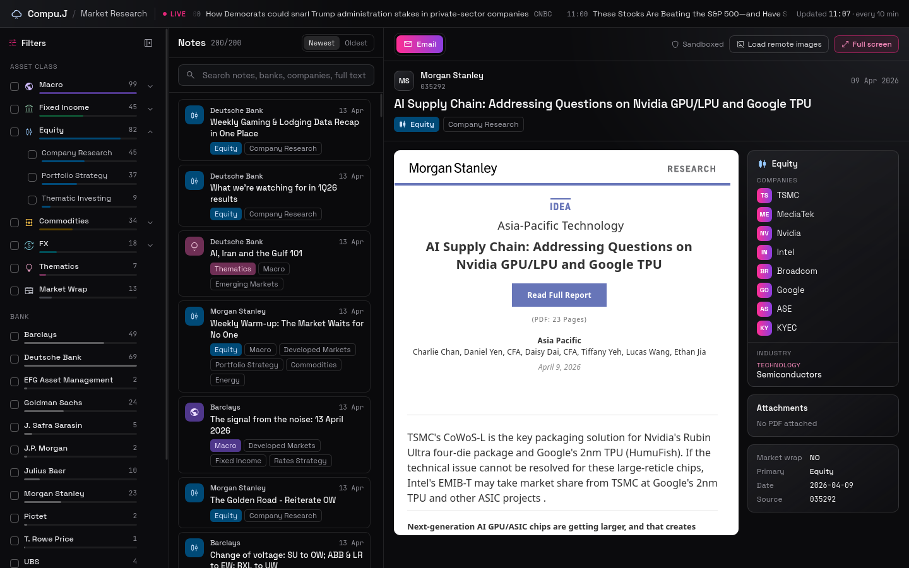

# Market research email classifier and dashboard



Two parts:

- **`classify.py`** reads each email folder, classifies it with one LLM call, and writes `classified_emails.json` (one entry per email, the brief's ten fields).
- **Dashboard** (`web/`, Svelte 5 on Bun) lets an analyst browse, search, filter and read the emails, with a live news ticker on top.

`PRD.md` explains the design and the reasoning behind it. `CLAUDE.md` is the build contract.

## Run it

You need [Bun](https://bun.sh) 1.4+ and [uv](https://docs.astral.sh/uv/). uv fetches Python and the pinned packages on first use; nothing else to install.

Put the dataset folder at `./Data` (or add `--data <path>` to either command), then:

```bash
bun run classify     # recreates classified_emails.json, offline, from the saved model answers
bun run dashboard    # installs, builds the search index and UI, serves http://127.0.0.1:3000
```

`bun run dashboard` alone is enough to see the project; `classified_emails.json` is already in the repo. The dashboard also refreshes the news headlines every 10 minutes while it runs.

### What `bun run classify` does

It runs `classify.py` over every email folder: extracts the text, PDFs and images, builds the prompt, applies the brief's rules and writes the outputs below. The model's answer for each email is saved in `llm_cache/`, keyed by a hash of the exact input (model, prompt, text and images). Those answers are committed, so on any machine the script finds every email already answered and produces the same JSON byte for byte, with no AI and no key. The model is only called for an email whose content, or the prompt, has changed. That needs either:

- [Claude Code](https://claude.com/claude-code) installed and logged in (the default provider, `--provider claude-code`, model `haiku`), or
- an Anthropic API key in `ANTHROPIC_API_KEY` (`--provider anthropic`, model `claude-sonnet-5-5`).

Other options: `--model sonnet` for another model, `--only 035239 035240` for a few emails, `--workers 4` for parallel calls, `--no-cache` to call the model for everything.

### Other commands

- `bun run test`: all tests (pytest, bun test, Svelte type check).
- `bun run news`: fetch headlines once.
- `cd web && bun run dev`: API plus a Vite dev server with hot reload (http://localhost:5173).

## Outputs

| File | What it holds |
| --- | --- |
| `classified_emails.json` | The deliverable. One record per email folder, exactly the ten fields in the brief's order. |
| `classification_log.jsonl` | Per email: where each value came from, the LLM's raw answer, rules that changed something, extraction warnings, errors. |
| `llm_cache/` | The model's saved answer per email (committed), so classification replays offline. |
| `flags.json` | Files outside the brief's folder definition (anything in `thumbs/`, non-PDF attachments, unreferenced or missing inline images). Not classified, not dropped. |
| `web/data/emails.db` | SQLite search index, rebuilt from the JSON. Never edited. |
| `web/data/news.json` | Latest headlines for the ticker. |

## How classification works

1. **Read** each folder: `emailbody.html` (required), every PDF, and the `inline/` images the HTML references.
2. **Extract** text: HTML always decoded as UTF-8; data tables kept as aligned rows, layout tables flattened; full PDF text; images in document order with their nearby text.
3. **Fill what is certain** in code: `source_file`, `pdf_attachment`, the folder name when it reads as a subject, and every date in the text with its context.
4. **One LLM call** per email with the full text, PDF text and images. The output is constrained to the brief's tag and industry lists by a JSON schema.
5. **Apply the brief's rules in code**, so every record follows them whatever the model returned: market wrap fields, tags in the list only, sub-tags bring their parent, primary tag in the tags, companies and industries for Equity only, `Unknown` industry when none fits, companies must appear in the text, date must be one of the dates found in the email.

Nothing is cut from the model's input and nothing is tied to a particular bank or template.

### Swapping the model

Every provider sits behind one small interface (`LLMClient` in `pipeline/llm.py`: `classify(system, user, images) -> LLMResult`), and `make_client(provider, model)` builds one by name. Two providers ship:

- `claude-code`: runs `claude -p` on the local Claude Code login. Each call is locked down (empty temp folder, no tools, no settings, no saved session) and the CLI enforces the JSON schema.
- `anthropic`: the Anthropic API through the official SDK.

Adding another (an OpenAI-compatible endpoint, a local model) is one class with a `classify` method and one entry in `PROVIDERS`. The cache key includes the provider and model, so switching never mixes results.

## Decisions on the brief's open points

| Question | Decision |
| --- | --- |
| `folder_name` when the folder is an ID | Every folder in the data is an ID (e.g. `035239`), so the title comes from the email content. A readable folder name would be used as is. |
| `pdf_attachment` shape | Always a list of filenames when there are PDFs, otherwise `null`. |
| No publication date | `null`. The model picks the publication date from dates found in the email, never invents one. |
| Several dates in one email | The model chooses using each date's context, so event dates, deadlines and sent timestamps aren't mistaken for the publication date. |
| Market wrap | Judged against the brief's definition and checklist as a whole, not by requiring every answer to be yes. |
| `Thematics` vs `Equity > Thematic Investing` | `Thematics` when there's no equity angle; `Equity` + `Thematic Investing` when the theme is expressed through stocks or sectors. |
| "Materially discussed" companies | The email says something about the company itself (business, results, estimates, valuation, rating, outlook). Peers named for comparison, examples, names in lists, tables, sources or disclaimers, and the publishing bank don't count. |
| Digest emails | Tag everything materially covered; the dominant topic is primary. |
| Duplicate emails | One record per folder, so duplicates are classified separately. |
| Unexpected files | Flagged in `flags.json` for another pass. |
| Model | Claude Haiku 5.5 through Claude Code by default: cheap, reads images, and runs on the user's own login. Larger models are one flag away. |
| Temperature | Neither provider takes sampling parameters. Stability comes from a fixed prompt, constrained output and the cache. |

## Dashboard

- Scrollable list with title, bank, date, PDF marker and asset tags; Newest/Oldest sort.
- Search across title, bank, companies, industries and the full email and PDF text, with highlighted matches.
- Multi-select filters for asset class (expandable to sub-tags), bank and month, each with counts. Active filters show as removable chips. OR within a filter, AND across filters.
- Reader with the email in a sandboxed iframe (no scripts; remote images off until you ask, since they can report the open to the sender), PDF tabs in the browser's viewer, an Equity panel (companies, industries), and full screen.
- News ticker from CNBC, MarketWatch, Yahoo Finance and FT Markets RSS feeds. It scrolls, pauses on hover, shows when it was last updated, and opens articles in a new tab.
- The view lives in the URL, so a filtered view or a selected note can be bookmarked or shared.

More screenshots: [search with filters](docs/screenshots/search-filters.png), [market wrap with its PDF](docs/screenshots/market-wrap-pdf.png).

### Why SQLite

The JSON is the deliverable and the source of truth. The index is derived from it so analysts can search inside the emails and PDFs, not just the tags, and filter with live counts. At this size the browser could filter the JSON alone; the index is for retrieval, not speed.

## Results and evaluation

The committed `classified_emails.json` comes from Claude Haiku 5.5 through Claude Code: 200 records, 0 errors. The brief's rules changed 3 values the model returned, and bank harmonisation merged 4 spellings (for example `UBP` into `Union Bancaire Privée`). Distribution (`eval/distribution_report.json`): primary tags Equity 73, Macro 68, Fixed Income 26, Market Wrap 13, Commodities 8, FX 8, Thematics 4; 12 banks; 7.5% without a date.

Scoring against hand labels:

```bash
uv run python -m eval.make_template          # picks ~20 emails by coverage, writes a blank eval/labels_template.json
# fill it in against the brief and save as eval/labels.json
uv run python -m eval.score --pred classified_emails.json --labels eval/labels.json
uv run python -m eval.score --pred run1.json --compare run2.json   # run-to-run agreement
```

The labels are left blank on purpose so they follow the brief, not the model. With a set this small the scores are an initial evaluation: they show where the pipeline fails, not representative accuracy.

## Tests

```bash
bun run test    # pytest for the pipeline, bun test for the API, UI logic and news, then the Svelte type check
```

No test touches the network or the LLM: they use small synthetic email folders, a fake LLM client and saved feed fixtures.

## Layout

```
classify.py, build_index.py   CLIs
pipeline/                     reader, html_text, images, pdfs, deterministic, prompt, llm, rules, run, index_db
tests/                        pytest, one file per module
web/server/                   Bun API (queries, safe file serving)
web/src/                      Svelte app (lib/ logic, components/)
web/scripts/fetch-news.ts     headline fetcher
docs/design/                  dashboard design reference
```
